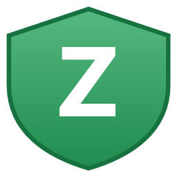
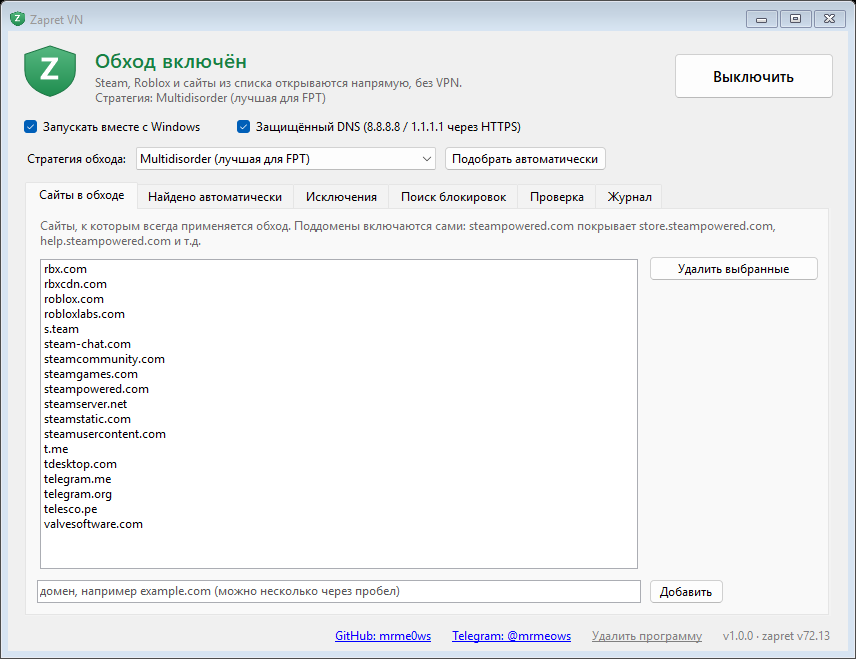
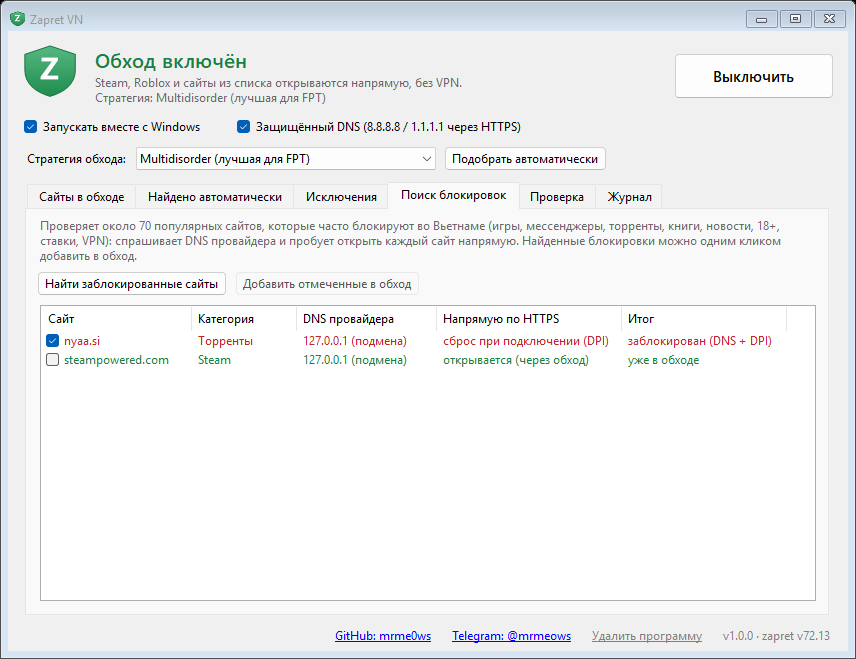

<div align="center">



# Zapret VN

**Обход блокировок Steam, Roblox и других сайтов во Вьетнаме — без VPN.**
Программа для Windows со значком в трее: включил — и всё открывается напрямую, на полной скорости.

[](https://github.com/MrMe0ws/zapret-vietnam/releases/latest)

[](LICENSE)



</div>

---

## Зачем это

Во Вьетнаме провайдеры (FPT, Viettel, VNPT…) блокируют Steam, часть Roblox, торрент-трекеры и многое другое. Блокировка двойная:

1. **DNS** — вместо настоящего адреса сайта провайдер отдаёт `127.0.0.1`.
   Поэтому «поставить DNS 8.8.8.8» помогает лишь частично — провайдер может перехватывать и обычные DNS-запросы.
2. **DPI** — провайдер читает имя сайта (SNI) в самом начале HTTPS-соединения и обрывает его.
   Именно это вызывает знаменитую **«ошибку 101»** в Steam, когда магазин то открывается, то нет.

Zapret VN решает обе проблемы:

- включает **DNS через HTTPS** (8.8.8.8 / 1.1.1.1) — провайдер больше не может подменить адрес;
- запускает **[zapret](https://github.com/bol-van/zapret)** — он режет и переставляет первые пакеты соединения так, что DPI не может прочитать имя сайта, а сервер собирает их обратно без проблем.

Трафик идёт **напрямую**, без VPN и чужих серверов: скорость загрузок и пинг в играх не меняются.

## Возможности

- 🛡️ **Значок в трее** — зелёный (обход включён) / серый (выключен). Клик — окно, правый клик — меню.
- ⏻ **Включение одной кнопкой**, автозапуск вместе с Windows.
- 🔒 **Защищённый DNS** (DoH) одной галочкой.
- 🤖 **Автообнаружение блокировок** — если незнакомый сайт 3 раза подряд оборвал соединение, он сам добавляется в обход.
- 🔍 **Поиск блокировок** — проверяет ~70 популярных сайтов (игры, мессенджеры, торренты, книги, новости, ставки, VPN…) у *вашего* провайдера и одним кликом добавляет заблокированные в обход.
- 🎯 **Автоподбор стратегии** — перебирает способы обхода и выбирает лучший для вашего провайдера.
- ✅ **Проверка** — открываются ли Steam / Roblox / Telegram прямо сейчас.
- 📝 Редактор списков: свои сайты, исключения (банки и т.п.).
- 📦 **Один файл** `ZapretVN.exe` (3,5 МБ) — внутри всё нужное, ничего доустанавливать не надо.

<details>
<summary>Скриншот: поиск блокировок</summary>

</details>

## Установка

1. Скачайте **`ZapretVN.exe`** из [последнего релиза](https://github.com/MrMe0ws/zapret-vietnam/releases/latest).
2. Запустите и нажмите **«Да»** в окне контроля учётных записей (нужны права администратора — драйвер перехвата пакетов).
   > Windows SmartScreen может предупредить «Неизвестный издатель» — программа не подписана платным сертификатом. Нажмите **«Подробнее» → «Выполнить в любом случае»**.
3. Программа установится в `C:\zapret-vietnam` и создаст ярлык **Zapret VN** на рабочем столе и в меню Пуск.
4. Нажмите **«Включить»** и согласитесь включить защищённый DNS.
5. Перезапустите Steam / Roblox.

Если провайдер не FPT (Viettel, VNPT…) и что-то не открывается — нажмите **«Подобрать автоматически»**.

> 💡 Windows 11 прячет новые значки под стрелочку `^` в трее. Перетащите щит на панель задач или включите его в *Параметры → Персонализация → Панель задач → Другие значки*.

## Вопросы

<details>
<summary><b>Это безопасно? Почему антивирус ругается?</b></summary>

Внутри — открытый [zapret](https://github.com/bol-van/zapret) (MIT) и драйвер [WinDivert](https://github.com/basil00/WinDivert) (LGPL). Некоторые антивирусы помечают WinDivert как «HackTool», потому что он умеет перехватывать сетевые пакеты — это ложное срабатывание. Весь исходный код программы — в этом репозитории, exe собирается из него одной командой.
</details>

<details>
<summary><b>Работает ли Roblox?</b></summary>

Да: приложение и игры (вход, сервера, друзья, чат). Главная страница **сайта** `www.roblox.com` из Вьетнама не отвечает на стороне самого Roblox — это не DPI, поэтому обход тут не помогает. Заходите через приложение.
</details>

<details>
<summary><b>Чем это отличается от VPN?</b></summary>

VPN гонит весь трафик через чужой сервер — растёт пинг, падает скорость, часто платно. Zapret VN ничего никуда не перенаправляет: он только меняет то, *как* выглядят первые пакеты соединения, чтобы фильтр провайдера их не распознал.
</details>

<details>
<summary><b>Как удалить?</b></summary>

В окне программы внизу — «Удалить программу». Удалятся служба, автозапуск, ярлыки и папка `C:\zapret-vietnam`; DNS по желанию вернётся к провайдерскому.
</details>

<details>
<summary><b>Как обновить?</b></summary>

Правый клик по щиту → **Выход** → «Да, оставить обход». Затем запустите новый `ZapretVN.exe` — он обновит установку, списки и настройки сохранятся.
</details>

## Сборка из исходников

Нужен только .NET Framework 4.8 (есть в любой Windows 10/11) — Visual Studio не требуется.

```bash
powershell -ExecutionPolicy Bypass -File src\build.ps1
```

Результат — `dist\ZapretVN.exe`. Подробности об устройстве проекта — в [CLAUDE.md](CLAUDE.md).

## Благодарности

- [bol-van/zapret](https://github.com/bol-van/zapret) — движок обхода DPI (winws)
- [basil00/WinDivert](https://github.com/basil00/WinDivert) — перехват пакетов в Windows

Сторонние компоненты и их лицензии — в [THIRD_PARTY_NOTICES.md](THIRD_PARTY_NOTICES.md).

## Автор

**Meows** — [GitHub @MrMe0ws](https://github.com/mrme0ws) · [Telegram @mrmeows](https://t.me/mrmeows)

Лицензия: [MIT](LICENSE).
